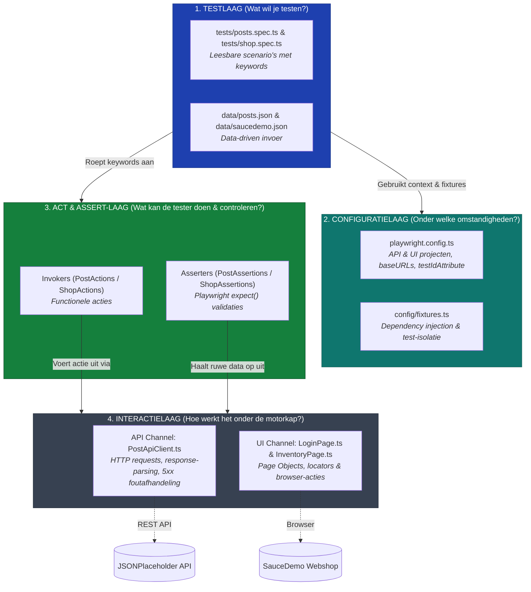

# SPARTA Test Automation Architectuur – Multi-Channel Demo (API & UI)

Dit project is een referentie-implementatie van de **SPARTA-architectuur** met **Playwright** en **TypeScript**. Het demonstreert hoe één uniforme testarchitectuur ingezet kan worden voor zowel **API-testing** (`://typicode.com`) als **UI-testing** (`saucedemo.com`).

De kern van SPARTA is een strikte scheiding tussen **wat** we testen (functionele testscenario's) en **hoe** dit technisch wordt uitgevoerd (endpoints, selectors, HTTP-requests en browser-acties).

---

## De 4 lagen van SPARTA

```text
┌─────────────────────────────────────────────────────────────────┐
│ 1. TESTLAAG (tests/ & data/)                                    │
│    Wat wil je testen? Leesbare scenario's + externe testdata.   │
├─────────────────────────────────────────────────────────────────┤
│ 2. CONFIGURATIELAAG (config/ & playwright.config.ts)            │
│    Onder welke omstandigheden? Projecten, fixtures, baseURLs.   │
├─────────────────────────────────────────────────────────────────┤
│ 3. ACT & ASSERT-LAAG (act-assert/)                              │
│    Wat kan de tester doen & controleren? Invokers & Asserters.  │
├─────────────────────────────────────────────────────────────────┤
│ 4. INTERACTIELAAG (interactie/)                                 │
│    Hoe werkt het onder de motorkap? API Clients & Page Objects. │
└─────────────────────────────────────────────────────────────────┘
• Test praat alleen tegen Act & Assert (en haalt data uit JSON).
• Act & Assert praat alleen tegen Interactie.
• Interactie praat alleen tegen de Website / API.
• En Configuratie hangt daar als een paraplu boven om alles klaar te zetten voordat de test begint.


```


### Overzicht van verantwoordelijkheden

| Laag | Bestanden in dit project | Bevat WEL | Bevat NIET |
| :--- | :--- | :--- | :--- |
| **1. Test** | `tests/posts.spec.ts`<br>`tests/shop.spec.ts`<br>`data/*.json` | • Functionele testscenario's<br>• Keywords uit Act & Assert<br>• Data-driven invoer (JSON) | • Endpoints of HTML-selectors<br>• HTTP-statuscodes<br>• `expect()`-validaties<br>• `if/else` of testlogica |
| **2. Configuratie** | `playwright.config.ts`<br>`config/fixtures.ts` | • Projecten (`api-tests` & `ui-tests`)<br>• `baseURL` & `testIdAttribute`<br>• Playwright Test Fixtures & isolatie | • Testscenario's<br>• API-calls of DOM-interacties<br>• Validaties |
| **3. Act & Assert** | `act-assert/PostActions.ts`<br>`act-assert/PostAssertions.ts`<br>`act-assert/ShopActions.ts`<br>`act-assert/ShopAssertions.ts` | • **Invokers** (functionele acties)<br>• **Asserters** (`expect()`-checks)<br>• Herbruikbare keywords | • Endpoints of selectors<br>• Response-parsing<br>• Testdatabeheer |
| **4. Interactie** | `interactie/PostApiClient.ts`<br>`interactie/LoginPage.ts`<br>`interactie/InventoryPage.ts` | • API-calls (`GET`, `POST`)<br>• Page Objects & locators<br>• Technische foutafhandeling (5xx) | • Functionele `expect()`-checks<br>• Testscenario's<br>• Omgevingsinstellingen |

---

## Architectuurprincipes in de praktijk

1. **Kanaalonafhankelijk (API & UI in één structuur):** In `playwright.config.ts` worden de specifieke eigenschappen per kanaal geconfigureerd (zoals headers voor de API en `testIdAttribute: 'data-test'` voor SauceDemo). Daarboven werken de Testlaag en Act & Assert-laag op exact dezelfde manier.
2. **Onderhoudbaarheid (Single Point of Change):** Verandert er een `data-test`-attribuut in de webshop of een endpoint in de API? Dan wordt uitsluitend de **Interactielaag** aangepast. De testscenario's en keywords blijven onaangeroerd.
3. **Zuivere scheiding tussen Actie en Validatie:** De **Interactielaag** haalt uitsluitend ruwe data op (bijv. een tekst uit de DOM of een JSON-response) en bewaakt de technische uitvoering. De **Act & Assert-laag** beoordeelt vervolgens of deze waarde functioneel klopt via Playwright `expect()`.
4. **Leesbaarheid & Data-Driven werken:** Doordat de **Testlaag** vrij is van technische code en `expect()`-regels, kunnen ook minder technische teamleden scenario's lezen en testdata uitbreiden in `data/posts.json` en `data/saucedemo.json`.

---

## Installatie & Uitvoeren

### Vereisten
* Node.js (v18 of hoger)

### Installatie
Installeer de dependencies en de benodigde Chromium-browser voor Playwright:
```bash
npm install
npx playwright install chromium
```

### Tests uitvoeren

**Alle tests draaien (API + UI parallel):**
```bash
npx playwright test
```

**Alleen de API-tests draaien:**
```bash
npx playwright test --project=api-tests
```

**Alleen de UI-tests draaien (headless):**
```bash
npx playwright test --project=ui-tests
```

**UI-tests zichtbaar in de browser bekijken:**
```bash
npx playwright test --project=ui-tests --headed
```

**HTML-rapportage bekijken na afloop:**
```bash
npx playwright show-report
```
